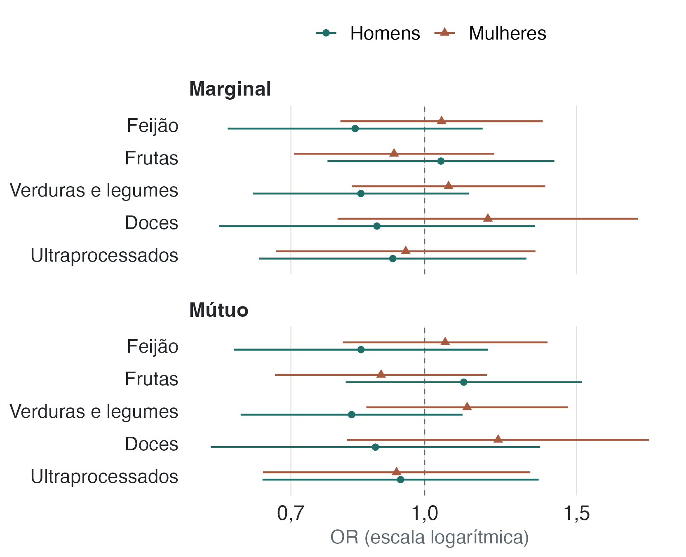
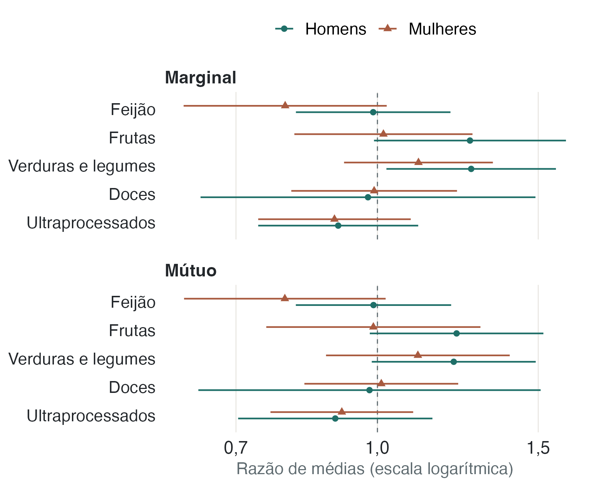
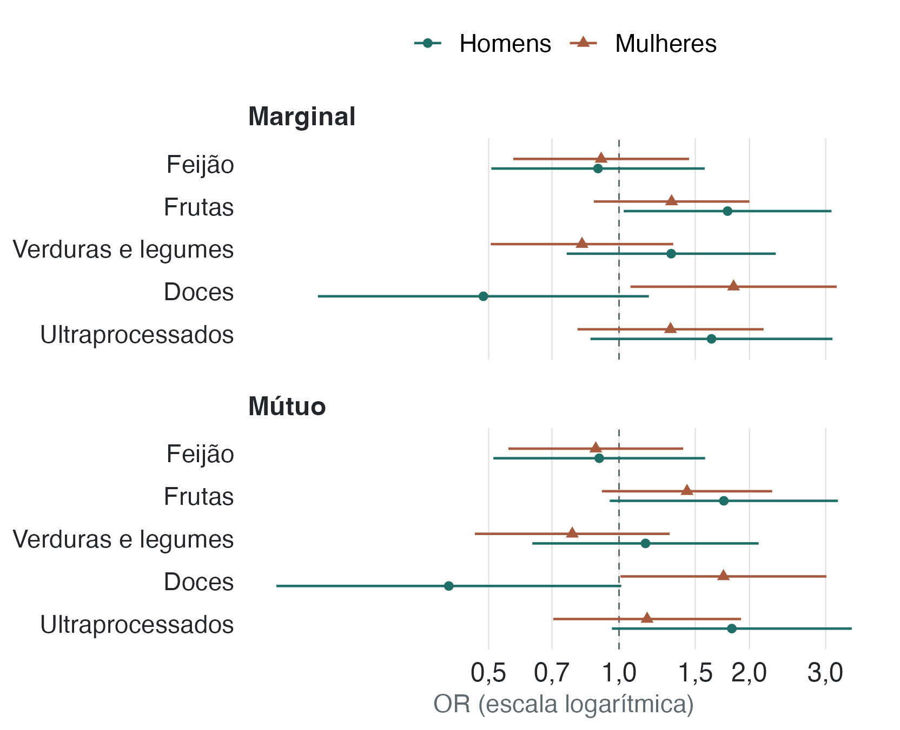

A análise investiga se as medidas de consumo alimentar variam junto com os
resultados de saúde. Como a pesquisa mediu alimentação e saúde no mesmo período,
não é possível concluir que uma cause a outra.

::: {.destaque}
Na comparação inicial, algumas diferenças entre grupos apareceram. Nos modelos
que consideram sexo, idade, escolaridade, renda, cor ou raça, estado civil e
características do domicílio, nenhuma das cinco medidas de alimentação mostrou
evidência estatística suficiente de associação com doença crônica, consultas ou
internações, depois da correção para múltiplas comparações. Esse resultado foi
semelhante nos dois tipos de modelo descritos abaixo.
:::

## O que as comparações iniciais mostraram

Comparamos o consumo regular de feijão, frutas, verduras e legumes, doces e
ultraprocessados com três resultados de saúde: diagnóstico de doença crônica,
consultas médicas e internações. Em cada grupo, foram 15 comparações. Entre
todos os participantes, seis tiveram q[^valor-q] abaixo de 0,05: feijão e
consultas, frutas e consultas, frutas e internações, verduras e doença crônica,
verduras e consultas e ultraprocessados e doença crônica.

Entre mulheres, duas das 15 comparações tiveram q abaixo de 0,05; entre homens,
uma. Esses resultados iniciais não mostram, por si só, o que acontece quando
levamos em conta diferenças de idade, renda e outras características, nem
indicam que o consumo causou os resultados de saúde.

[^valor-q]: O valor q é o valor de p ajustado pelo procedimento de
Benjamini-Hochberg para levar em conta os vários testes feitos dentro de cada
conjunto de comparações.

::: {.panel-tabset}
## Todos



## Mulheres



## Homens


:::

**Tabela 1.** Valores q, ajustados por Benjamini-Hochberg, para as 15 comparações
principais em cada grupo. O asterisco marca q < 0,05. Cada célula compara os
resultados de quem consome regularmente o alimento com os de quem consome com
menor frequência.

::: {.callout-note collapse="true"}
## Ver as 40 comparações exploratórias

A análise exploratória compara cinco medidas de consumo alimentar com oito
resultados de saúde: hipertensão, diabetes, doença do coração, AVC, depressão,
câncer, indisposição frequente e sentir-se deprimido com frequência. Na vista direta, 5 das 40 comparações tinham
q < 0,05; dentro de cada sexo, nenhuma.

::: {.panel-tabset}
## Todos



## Mulheres



## Homens


:::
:::

## O que mostram os modelos ajustados

Usamos modelos de regressão para comparar os resultados de saúde entre grupos,
considerando sexo, idade, escolaridade, renda, cor ou raça, estado civil e
características do domicílio. Para doença crônica e internação, que são
registradas como sim ou não, usamos regressão quasi-binomial. Para a contagem de
consultas, usamos regressão quasi-Poisson. No ajuste marginal, cada medida de
consumo alimentar entra separadamente; no mútuo, as cinco entram juntas.

Para doença crônica e internação, os modelos estimam uma razão de chances
(*odds ratio*, OR). Aqui, chances é um termo estatístico: a relação entre a
probabilidade de o evento ocorrer e a de não ocorrer. O OR compara essa relação
entre grupos; não representa diretamente uma diferença de probabilidade. Para
consultas, os modelos comparam as médias. Em ambas as medidas, 1 indica que as
estimativas são iguais entre os grupos. Os intervalos de confiança mostram a
incerteza; a conclusão também considera a correção para múltiplos testes.

{fig-alt="Estimativas de OR e intervalos de confiança para cada alimento, separadas por sexo e tipo de ajuste. Todos os intervalos incluem 1, valor que representa ausência de diferença."}

::: {.callout-note collapse="true"}
## Números exatos: doença crônica (ajuste mútuo)


:::

{fig-alt="Estimativas da razão de médias de consultas e intervalos de confiança por alimento, sexo e tipo de ajuste. No modelo marginal, a estimativa para verduras entre homens é maior que 1 e o intervalo não inclui 1; no modelo mútuo, o intervalo inclui 1. Após a correção para múltiplas comparações, nenhum resultado dos modelos teve q abaixo de 0,05."}

::: {.callout-note collapse="true"}
## Números exatos: consultas (ajuste mútuo)


:::

{fig-alt="Estimativas de OR e intervalos de confiança para internação por alimento, separadas por sexo e tipo de ajuste. A maioria dos intervalos inclui 1. Para doces entre mulheres, a estimativa é maior que 1, mas o teste de interação não permanece significativo após a correção para múltiplas comparações."}

::: {.callout-note collapse="true"}
## Números exatos: internação (ajuste mútuo)


:::

## Doces e internações: um sinal incerto

No modelo mútuo, a razão de chances estimada para internação, ao comparar
homens que relataram comer doces em cinco ou mais dias por semana com os que
relataram menor frequência, foi 0,40 (IC 95% 0,16–1,01). Entre as mulheres, a
estimativa correspondente foi 1,74 (1,01–3,01). A comparação formal entre esses
resultados é o teste de interação entre consumo de doces e sexo: OR 4,31
(1,47–12,62), com p = 0,008. Após a correção para múltiplos testes, q = 0,079,
acima do limite de 0,05 adotado no estudo.

As estimativas por sexo apontam em direções opostas, mas o teste de interação
não passou o critério corrigido. Assim, não há evidência suficiente para
concluir que a associação difira entre homens e mulheres. O resultado é uma
hipótese a investigar, não um achado confirmado.

::: {.nota}
**Por que o ajuste muda a leitura.** Sexo, idade, escolaridade e renda se
associam tanto ao que as pessoas comem quanto aos desfechos. Quando essas
características entram no modelo, parte do sinal da análise simples desaparece.
Isso é compatível com confundimento, embora o ajuste também possa reduzir a
precisão das estimativas.

**O que um resultado não significativo significa.** Não encontrar evidência
estatística suficiente não prova que uma associação não exista. Significa que,
com este recorte, estas medidas e a precisão dos dados, a análise não permite
confirmá-la.

**Vários testes.** Os 174 testes descritivos e exploratórios incluem 45
comparações principais, 120 exploratórias e nove entre homens e mulheres. Nos
modelos, os testes de cada resultado e tipo de ajuste são corrigidos em conjuntos
separados.
:::
