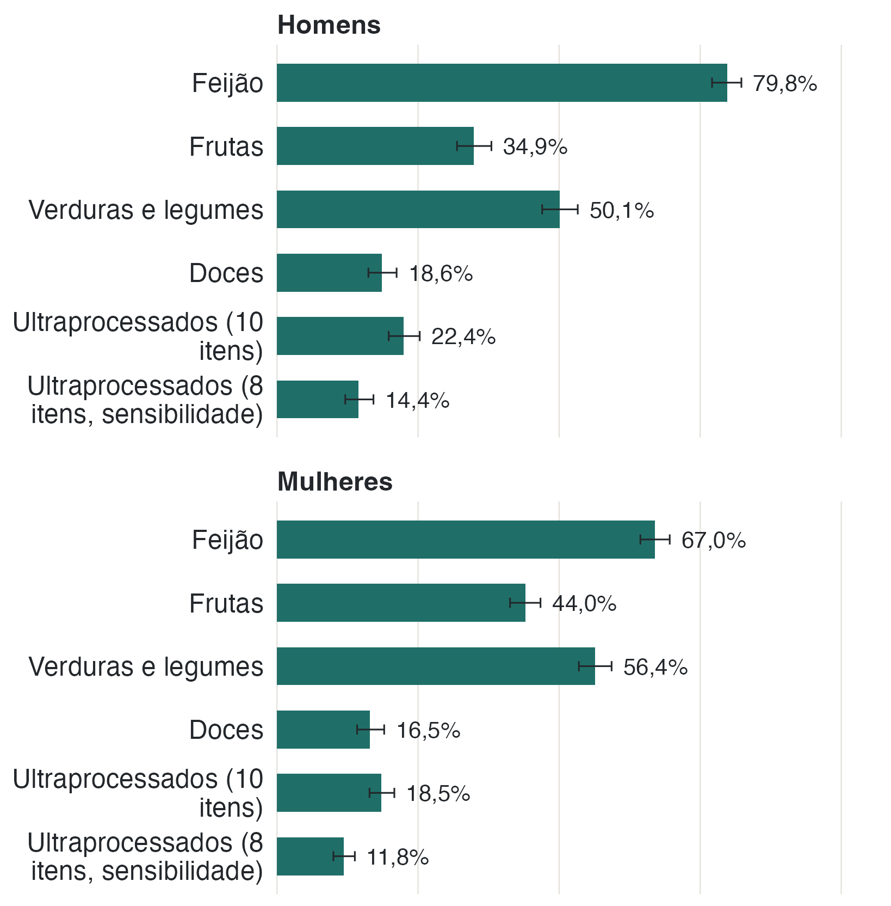

A PNS pergunta com que frequência a pessoa come feijão, frutas, verduras e
legumes, doces e outros itens. Também pergunta quais grupos de alimentos
industrializados foram consumidos no dia anterior.

::: {.callout-note appearance="simple"}
## Como lemos o consumo

- **Consumo regular**: cinco ou mais dias por semana. Vale para feijão, frutas,
  verduras e legumes e doces.
- **Ultraprocessados**: contagem de dez grupos consumidos no dia anterior
  (bebidas adoçadas, salgadinhos, biscoitos, embutidos, entre outros). O estudo
  usa cinco ou mais grupos como indicador; esse corte não é uma classificação
  clínica ou nutricional.
- **Versão de 8 itens**: a mesma conta sem os dois itens de doce, usada para
  checar se o resultado depende dessa sobreposição.
- A pergunta mede **frequência, não quantidade**. Comer feijão cinco dias por
  semana não diz quanto feijão a pessoa come.
:::



{fig-alt="Barras horizontais com a prevalência de consumo regular de feijão, frutas, verduras e legumes, doces e ultraprocessados, em painéis de homens e mulheres."}

## Feijão é o item mais frequente

O feijão aparece em 73,0% (IC 95% 70,9–75,0) da população, bem acima dos outros
itens. Verduras e legumes vêm em seguida, com 53,5% (51,2–55,8), e frutas com
39,7% (37,6–41,9). Doces ficam em 17,5% (15,8–19,2).

Nos ultraprocessados, 20,3% (18,4–22,3) consumiram cinco ou mais grupos no dia
anterior. Na versão de oito itens, sem os doces, a prevalência cai para 13,0%
(11,5–14,7). Em média, as pessoas consumiram 3,0 grupos de ultraprocessados
(IC 95% 2,89–3,10), de um total de dez.

## Homens e mulheres comem diferente

As diferenças entre os sexos aparecem em quase todos os itens. Homens consomem
mais feijão (79,8% contra 67,0%) e mais ultraprocessados (22,4% contra 18,5%).
Mulheres consomem mais frutas (44,0% contra 34,9%) e mais verduras e legumes
(56,4% contra 50,1%). Doces ficam próximos: 18,6% entre homens e 16,5% entre
mulheres, uma diferença que não se sustenta estatisticamente.

::: {.nota}
**Sobreposição entre doces e ultraprocessados.** Entre quem come doces cinco ou
mais dias por semana, 65,3% consumiram algum doce no dia anterior; entre os
demais, 32,4%. Por isso, o indicador de dez grupos inclui parte do consumo de
doces. Ao retirar esses dois itens, a conclusão geral dos três modelos foi
semelhante. Na análise de consultas entre mulheres, porém, a razão de médias foi
0,79 (IC 95% 0,66–0,93; p = 0,006), equivalente a uma média estimada 21% menor
entre quem consumiu cinco ou mais grupos. Como essa checagem não teve correção
adicional para múltiplos testes, o resultado é exploratório.

**O que "regular" não significa.** O indicador não classifica o alimento como
saudável ou não saudável, nem mede porção. Ele separa quem consome em cinco ou
mais dias da semana de quem consome com menor frequência.
:::
