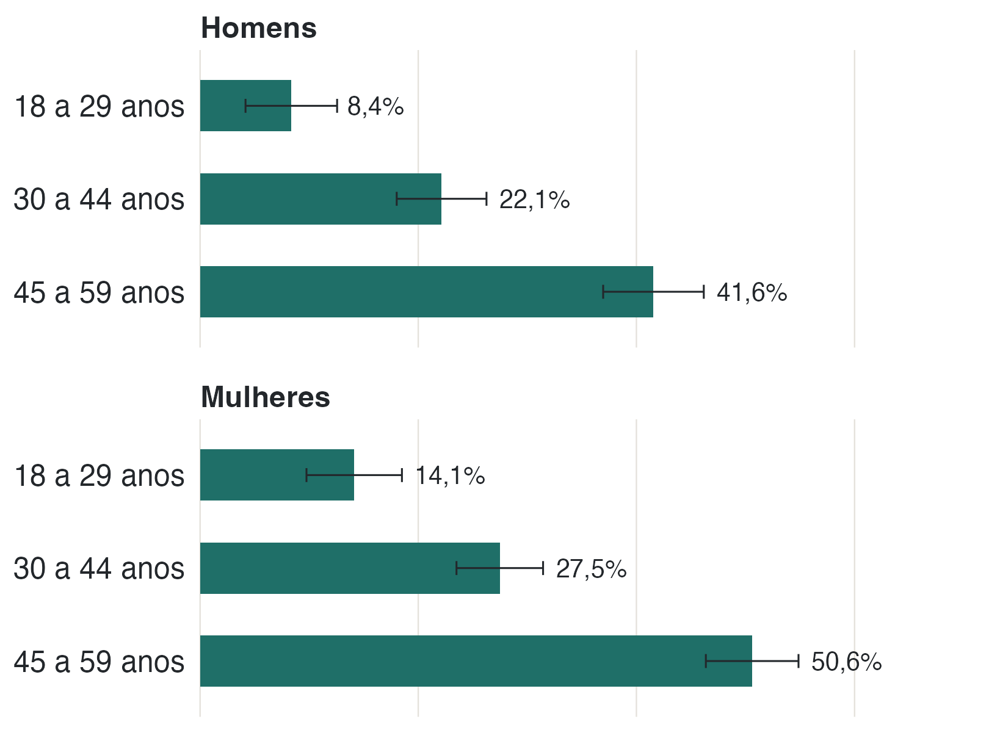
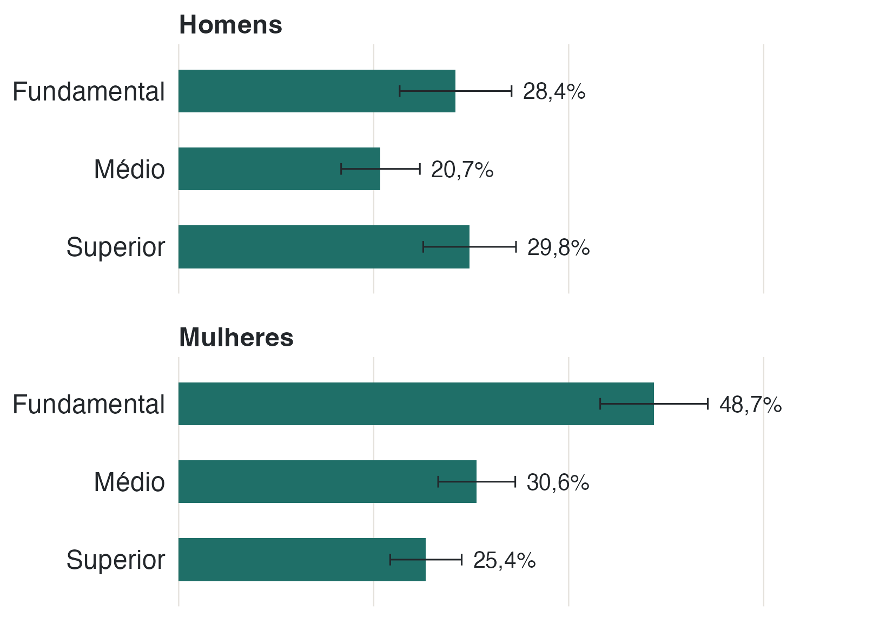
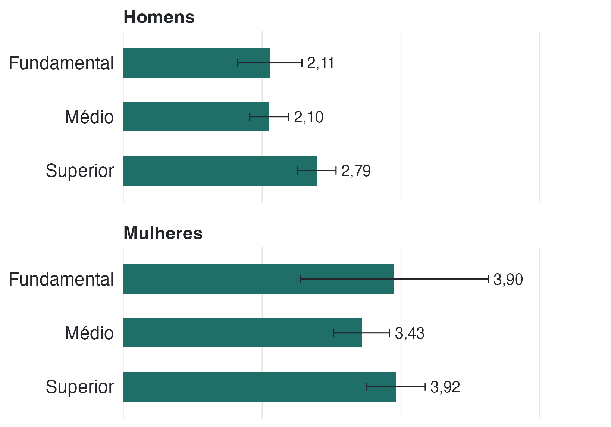

A escolaridade separa os resultados de forma clara entre as mulheres, mas não
entre os homens. As figuras abaixo são descritivas: mostram a prevalência
estimada em cada grupo, sem ajustar por outras características.

{fig-alt="Barras horizontais com a prevalência de doença crônica por faixa etária, em painéis de homens e mulheres, mostrando aumento com a idade."}

## A idade explica parte do padrão

A prevalência de doença crônica sobe com a idade nos dois sexos. Entre homens,
vai de 8,4% na faixa de 18 a 29 anos para 41,6% na de 45 a 59. Entre mulheres,
vai de 14,1% para 50,6%. Esse é o comportamento esperado para doenças crônicas e
ajuda a interpretar o restante.

{fig-alt="Barras horizontais com a prevalência de doença crônica por escolaridade, em painéis de homens e mulheres. Entre mulheres, a prevalência cai do fundamental para o superior; entre homens, não há padrão claro."}

## Entre mulheres, a diferença é grande

Entre as mulheres, a prevalência de doença crônica é de 48,7% (IC 95%
43,2–54,3) no ensino fundamental, 30,6% (26,6–34,5) no médio e 25,4%
(21,7–29,0) no superior. A diferença entre fundamental e superior é de mais de
vinte pontos percentuais.

Entre os homens, o padrão não se repete: 28,4% (22,7–34,1) no fundamental, 20,7%
(16,7–24,7) no médio e 29,8% (25,1–34,6) no superior. Os intervalos se sobrepõem
e não há gradiente claro.

{fig-alt="Barras horizontais com a média de consultas em 12 meses por escolaridade, em painéis de homens e mulheres. As médias não seguem um gradiente claro."}

## Consultas não acompanham a escolaridade

A média de consultas não segue o mesmo desenho. Entre mulheres, é de 3,90
(2,55–5,25) no fundamental, 3,43 (3,03–3,84) no médio e 3,92 (3,50–4,35) no
superior. Entre homens, 2,11 (1,65–2,57), 2,10 (1,82–2,38) e 2,79 (2,51–3,06).
Não há um gradiente consistente.

::: {.nota}
**Sem ajuste.** Estas figuras não controlam idade, renda ou outros fatores. Como
escolaridade, idade e renda estão correlacionadas, não é possível atribuir a
diferença a um fator isolado.

**Categorias omitidas.** Sem instrução e alfabetização têm menos de 30 pessoas em
cada sexo. As estimativas ficam instáveis (um dos grupos tem 5 pessoas e 100% de
prevalência), então essas categorias não aparecem nas figuras. Elas continuam na
tabela completa do relatório.

**Escolaridade e renda.** A PNS mede as duas coisas, mas este recorte usa a
escolaridade como marcador socioeconômico principal, porque tem menos ausentes e
é mais estável entre adultos jovens.
:::

::: {.callout-note collapse="true"}
## Tabela completa dos gradientes por escolaridade


:::
