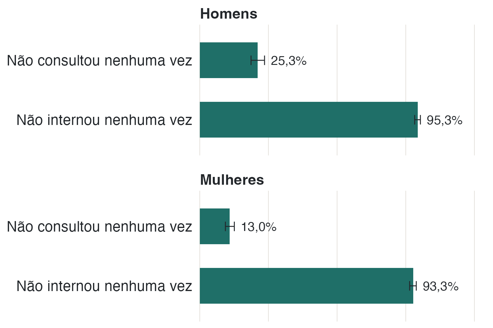

Entre os nove indicadores comparados, oito apresentaram diferenças
estatisticamente detectáveis entre homens e mulheres (q < 0,05), após o ajuste
para múltiplas comparações.





: **Tabela 1.** Indicadores por sexo. Percentuais para prevalências; médias para
consultas, internações e idade. q é o valor de p ajustado por Benjamini-Hochberg
dentro da família de nove testes; o asterisco marca q < 0,05.

## As diferenças vão na mesma direção

Mulheres relatam mais doença crônica (33,0% contra 25,4%), mais depressão (10,4%
contra 4,8%) e mais consultas (3,73 contra 2,39 por pessoa em 12 meses). Homens
relatam mais consumo regular de feijão (79,8% contra 67,0%) e mais
ultraprocessados (22,4% contra 18,5%); mulheres relatam mais frutas (44,0%
contra 34,9%) e mais verduras e legumes (56,4% contra 50,1%).

O único indicador sem diferença estatística é o consumo de doces: 18,6% entre
homens e 16,5% entre mulheres (q = 0,22).

{fig-alt="Barras horizontais com o percentual de pessoas que não consultaram e que não internaram nenhuma vez em 12 meses, mostrando que a não utilização é mais comum entre homens."}

## O que essas diferenças podem significar

As mulheres podem ter mais doenças, buscar mais os serviços de saúde ou ter mais
oportunidade de receber um diagnóstico porque consultam com maior frequência.
Como a pesquisa é transversal e os diagnósticos são autorrelatados, estes dados
não permitem distinguir essas explicações.

A idade média também difere: 38,3 anos entre homens e 39,2 entre mulheres. A
diferença é detectável estatisticamente, mas pequena em termos práticos. Um
resultado estatisticamente significativo não é necessariamente importante na
vida cotidiana.

::: {.nota}
**Várias comparações.** Ao testar muitos indicadores, aumenta a possibilidade
de encontrar diferenças por acaso. O procedimento de Benjamini-Hochberg ajusta
os valores de p dentro da família de nove comparações entre sexos. A tabela
apresenta esses valores ajustados, chamados q.

**Leitura de grupo.** As diferenças descrevem grupos, não pessoas. Dizer que
mulheres consultam mais, em média, não diz nada sobre uma mulher específica.
:::
