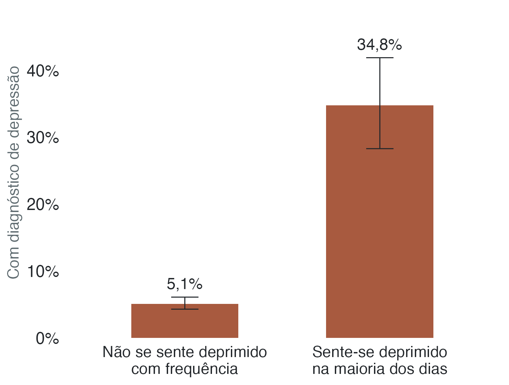

A PNS faz duas perguntas diferentes: com que frequência a pessoa se sentiu
deprimida nas últimas duas semanas e se algum médico ou profissional de saúde
mental já informou um diagnóstico. As respostas podem estar relacionadas, mas
não medem a mesma coisa.

{fig-alt="O diagnóstico de depressão foi relatado por 5,1% das pessoas que não se sentiram deprimidas com frequência e por 34,8% das que se sentiram assim na maioria dos dias."}

## Relato de sintoma e diagnóstico nem sempre coincidem

Entre as pessoas que se sentem deprimidas na maioria dos dias, 34,8% relataram
ter recebido diagnóstico de depressão. Entre as que não se sentem assim, 5,1%
relataram diagnóstico. No primeiro grupo, 65,2% não relataram esse diagnóstico.

As duas respostas coincidem parcialmente. O kappa ponderado é 0,32 (erro padrão
0,03). Nessa medida, 1 representa concordância perfeita e 0 (zero) indica que a
concordância não supera o esperado ao acaso. O valor foi 0,32 entre homens e
0,30 entre mulheres.

::: {.nota}
**O que cada pergunta mede.** Uma pergunta é sobre a frequência com que a
pessoa se sentiu deprimida nas últimas duas semanas. A outra pergunta se algum
médico ou profissional de saúde mental já informou um diagnóstico, sem limitar
um período. As respostas medem coisas diferentes; o estudo não avalia a
capacidade de diagnosticar depressão.

**Por que isso importa.** Sintoma frequente sem diagnóstico pode indicar
dificuldade de acesso, subdiagnóstico ou simplesmente que a pessoa não procurou
ajuda. Os dados deste site não permitem distinguir essas explicações.

**Grupo menor.** A comparação inclui 302 pessoas que relataram sentir-se
deprimidas na maioria dos dias. As estimativas para esse grupo são menos
precisas do que as dos indicadores gerais.
:::
