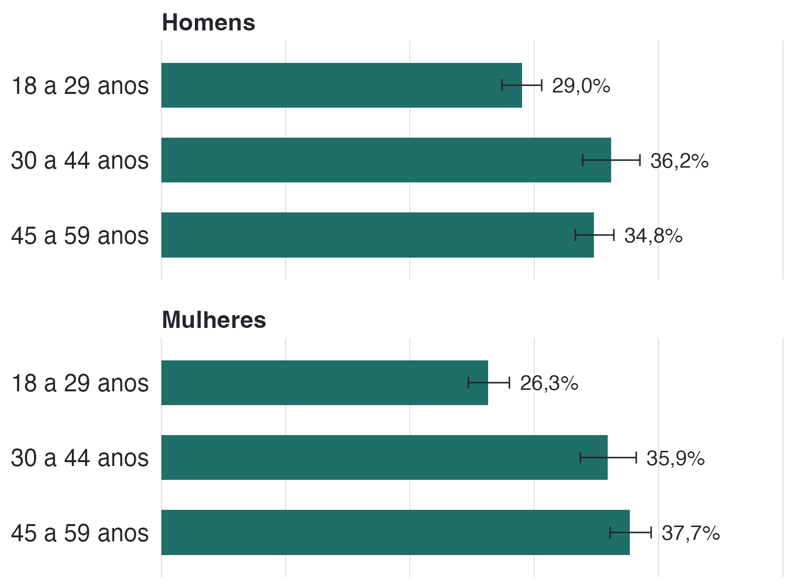
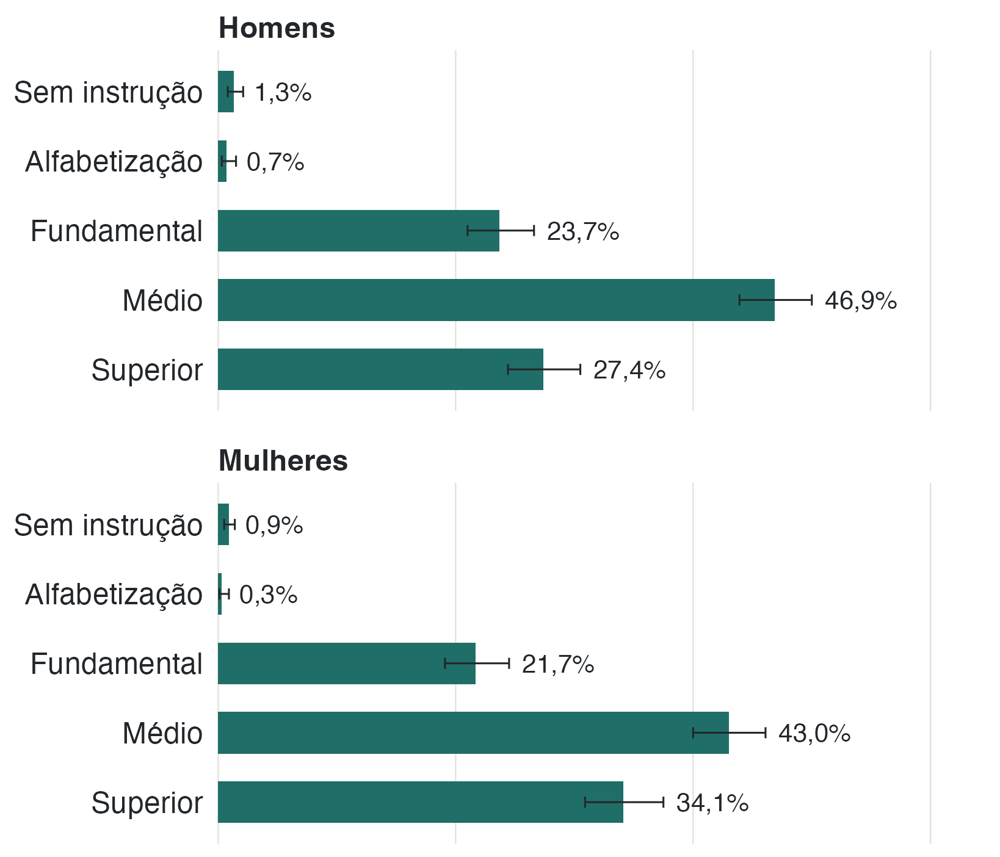
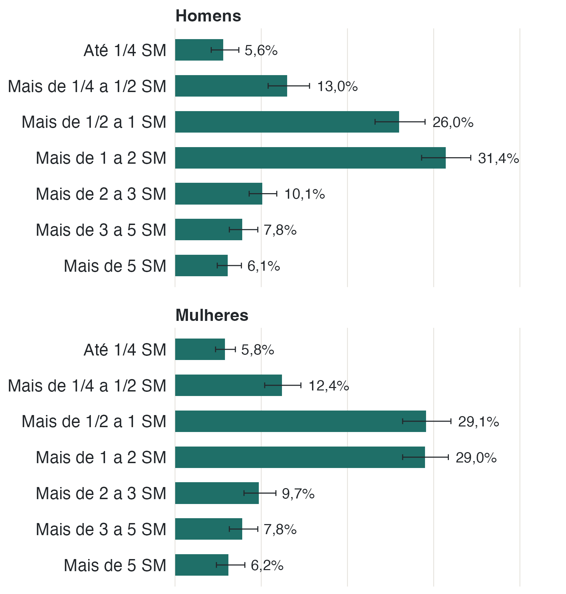
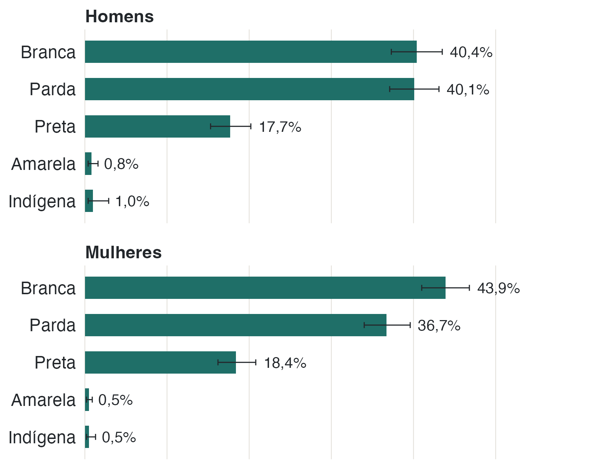

A Pesquisa Nacional de Saúde de 2019 é uma pesquisa domiciliar feita pelo IBGE
em parceria com o Ministério da Saúde. Em cada domicílio sorteado, um morador
adulto foi selecionado para responder ao questionário. A base usada neste
trabalho tem 90.846 moradores selecionados no Brasil.

Para este trabalho, o recorte é o estado do Rio de Janeiro e a faixa de 18 a 59
anos, com homens e mulheres. O caminho até a amostra final está na tabela
abaixo.



: **Tabela 1.** Do Brasil ao recorte do estudo. A última coluna mostra quanto
cada etapa representa da anterior. Fonte: PNS 2019.

São 3.242 pessoas, 1.498 homens e 1.744 mulheres. Como a PNS é uma amostra
complexa, com pesos diferentes para cada pessoa, esses números não descrevem
apenas quem respondeu: com o peso amostral, eles representam a população de 18 a
59 anos do estado.

## O retrato da população

A distribuição por idade é equilibrada: 27,6% têm de 18 a 29 anos, 36,0% têm de
30 a 44 e 36,4% têm de 45 a 59. A idade média é de 38,8 anos (IC 95% 38,6–39,0).

{fig-alt="Barras horizontais com a distribuição por faixa etária, separadas em dois painéis, homens e mulheres. As três faixas têm percentuais próximos entre si."}

A escolaridade se concentra no ensino médio: 44,9% das pessoas têm esse nível,
31,0% têm superior, 22,6% têm fundamental e 1,6% estão sem instrução ou apenas
alfabetizadas. A renda domiciliar per capita mediana é de R$ 1.033, e 18,4% da
população vive com até meio salário mínimo por pessoa.

{fig-alt="Barras horizontais com a distribuição por escolaridade, em painéis de homens e mulheres. O ensino médio é a categoria mais frequente nos dois sexos."}

{fig-alt="Barras horizontais com a distribuição por faixas de renda domiciliar per capita, em salários mínimos, separadas por sexo."}

A maioria se declara branca (42,2%) ou parda (38,3%); 18,1% se declara preta. A
população é quase toda urbana (96,9%), distribuída entre a capital (38,8%), o
resto da região metropolitana (34,6%) e o resto do estado (26,6%). Quanto ao
estado civil, 44,0% são casados e 47,8% são solteiros.

{fig-alt="Barras horizontais com a distribuição por cor ou raça declarada, em painéis de homens e mulheres. Branca e parda somam a maior parte."}

::: {.nota}
**Por que 18 a 59 anos.** O recorte para em 59 anos. A partir dos 60, a
frequência de doenças crônicas sobe muito e o grupo ficaria dominado por esse
efeito de idade. O piso em 18 marca o início da vida adulta.

**Categorias pequenas.** Sem instrução (1,1%) e alfabetização (0,5%) somam 61
pessoas no recorte. Os percentuais aparecem nas figuras, mas o intervalo de
confiança é largo e essas categorias não entram nas comparações por
escolaridade, onde seriam instáveis.

**Peso amostral.** Cada pessoa da PNS representa um número diferente de pessoas
da população. Por isso os percentuais do site não coincidem com a contagem
simples de respostas.
:::
