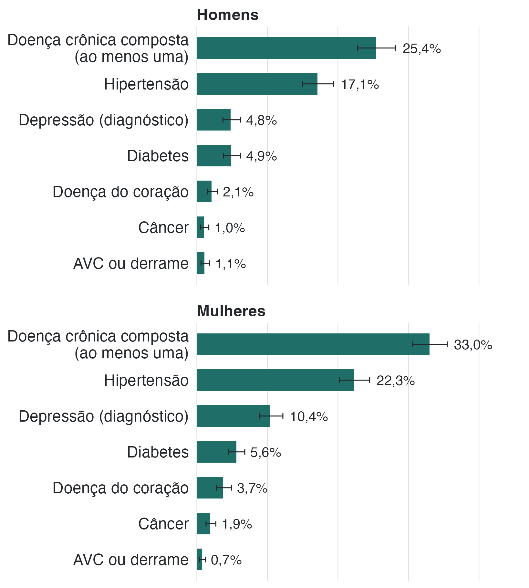
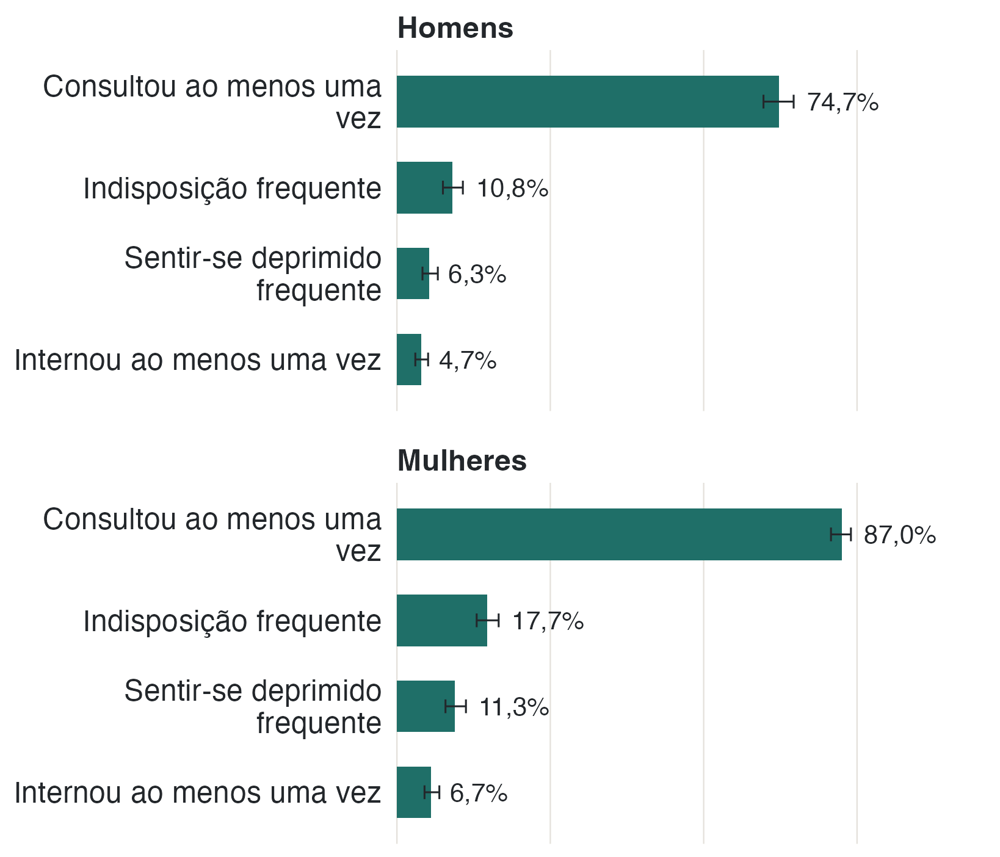

A análise reúne diagnósticos de doenças crônicas, relatos sobre saúde e uso de
serviços. As informações foram fornecidas pelas próprias pessoas: não houve
consulta a prontuários para confirmar diagnósticos ou atendimentos.



{fig-alt="Barras horizontais com a prevalência de doença crônica composta, hipertensão, depressão, diabetes, doença do coração, câncer e AVC, em painéis de homens e mulheres."}

## Quase três em cada dez relatam diagnóstico de doença crônica

A medida composta reúne seis condições: hipertensão, diabetes, doença do
coração, AVC, depressão e câncer. Ela indica se a pessoa relatou diagnóstico de
pelo menos uma delas. A prevalência estimada é de 29,5% (IC 95% 27,7–31,4).

A hipertensão é a mais frequente (19,9%; 18,4–21,5), seguida de depressão (7,8%;
6,8–9,0) e diabetes (5,2%; 4,5–6,1). Doença do coração (2,9%), câncer (1,5%) e
AVC (0,9%) são menos frequentes, com estimativas menos precisas e intervalos
relativamente mais largos.

{fig-alt="Barras horizontais com a prevalência de consulta médica, indisposição frequente, sentir-se deprimido com frequência e internação, em painéis de homens e mulheres."}

## Consultas são muito mais comuns que internações

Em 12 meses, 81,3% (IC 95% 79,5–82,9) consultaram um médico ao menos uma vez,
e 5,8% (4,9–6,8) foram internados. A média foi de 3,11 consultas por pessoa
(2,87–3,34); metade consultou até duas vezes e 90% tiveram seis consultas ou
menos. A média de internações foi de 0,08 por pessoa (0,06–0,10).

Em 12 meses, 18,7% não consultaram nenhuma vez e 94,2% não foram internados. As
internações, portanto, ocorreram em uma parcela pequena da população.

{fig-alt="Barras horizontais com o percentual de pessoas que não consultaram e que não internaram nenhuma vez em 12 meses, em painéis de homens e mulheres."}

::: {.nota}
**Pessoas sem consultas ou internações.** O questionário não pergunta quantas
vezes a pessoa usou o serviço se ela respondeu que não o utilizou no último ano.
Nesses casos, a quantidade foi considerada zero, e não dado ausente.

**Respostas ausentes.** A medida composta fica sem estimativa quando falta
resposta para alguma das seis condições. Isso ocorreu com 157 pessoas (4,8% do
recorte). Esses valores não foram preenchidos; nas doenças individuais, a
proporção de respostas ausentes é menor.

**Diagnósticos relatados.** A PNS pergunta se algum médico já informou à pessoa
que ela tem determinada doença. Como não há confirmação em prontuário ou exame,
os resultados também podem refletir diferenças no acesso aos serviços de saúde.
:::
